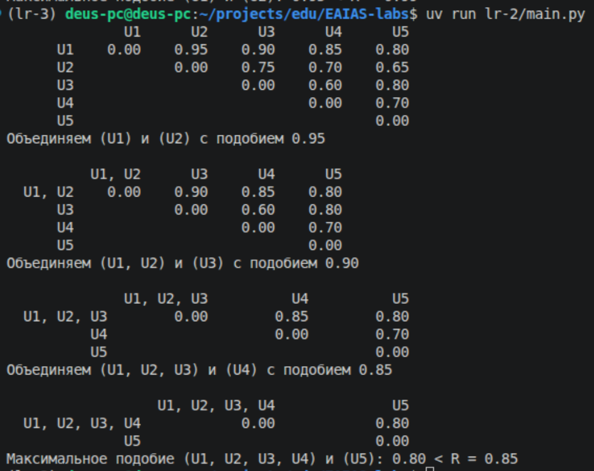

## Задание 2

Для запуска:
`uv run lr-2/main.py`

Результат работы:
```bash
              U1      U2      U3      U4      U5
      U1    0.00    0.95    0.90    0.85    0.80
      U2            0.00    0.75    0.70    0.65
      U3                    0.00    0.60    0.80
      U4                            0.00    0.70
      U5                                    0.00
Объединяем (U1) и (U2) с подобием 0.95

          U1, U2      U3      U4      U5
  U1, U2    0.00    0.90    0.85    0.80
      U3            0.00    0.60    0.80
      U4                    0.00    0.70
      U5                            0.00
Объединяем (U1, U2) и (U3) с подобием 0.90

              U1, U2, U3          U4          U5
  U1, U2, U3        0.00        0.85        0.80
          U4                    0.00        0.70
          U5                                0.00
Объединяем (U1, U2, U3) и (U4) с подобием 0.85

                  U1, U2, U3, U4              U5
  U1, U2, U3, U4            0.00            0.80
              U5                            0.00
Максимальное подобие (U1, U2, U3, U4) и (U5): 0.80 < R = 0.85
```


