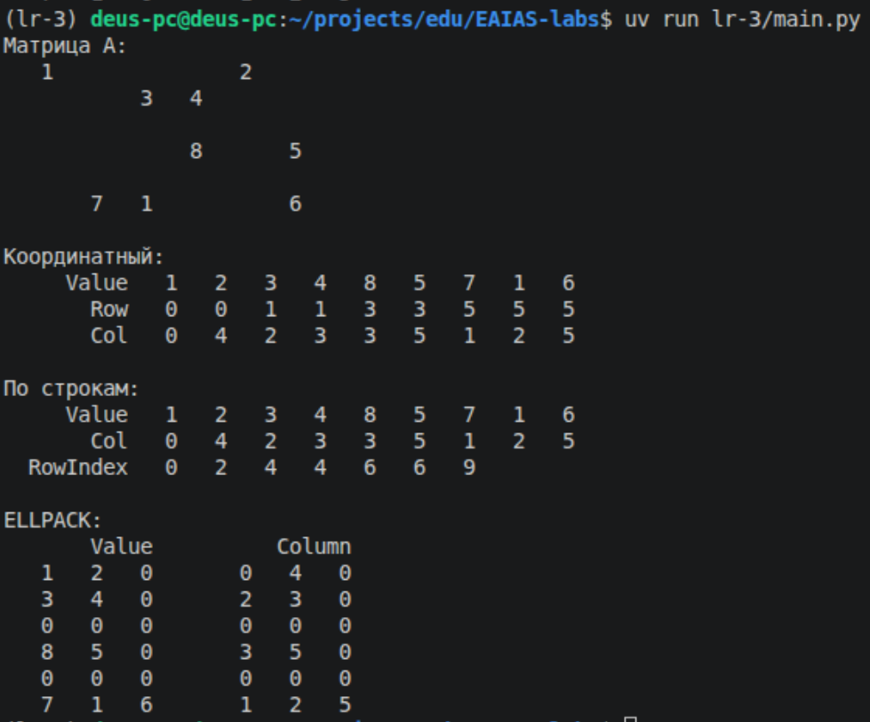

## Задание 3

Для запуска:
`uv run lr-3/main.py`

Результат работы:
```bash
Матрица A:
   1               2    
           3   4        
                        
               8       5
                        
       7   1           6

Координатный:
     Value   1   2   3   4   8   5   7   1   6
       Row   0   0   1   1   3   3   5   5   5
       Col   0   4   2   3   3   5   1   2   5

По строкам:
     Value   1   2   3   4   8   5   7   1   6
       Col   0   4   2   3   3   5   1   2   5
  RowIndex   0   2   4   4   6   6   9

ELLPACK:
       Value          Column
   1   2   0       0   4   0
   3   4   0       2   3   0
   0   0   0       0   0   0
   8   5   0       3   5   0
   0   0   0       0   0   0
   7   1   6       1   2   5
```


