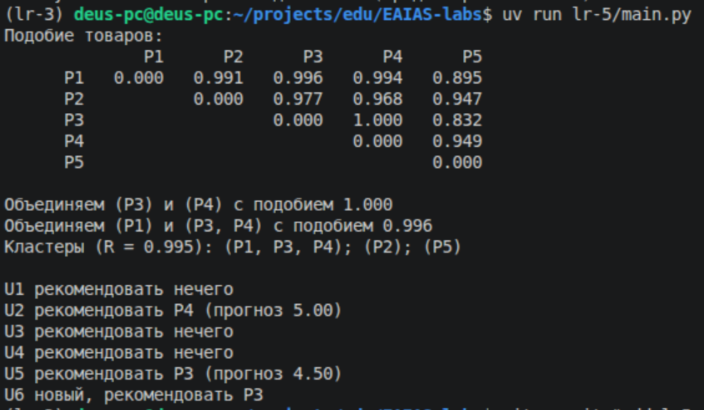

## Задание 5

Для запуска:
`uv run lr-5/main.py`

Результат работы:
```bash
Подобие товаров:
              P1      P2      P3      P4      P5
      P1   0.000   0.991   0.996   0.994   0.895
      P2           0.000   0.977   0.968   0.947
      P3                   0.000   1.000   0.832
      P4                           0.000   0.949
      P5                                   0.000

Объединяем (P3) и (P4) с подобием 1.000
Объединяем (P1) и (P3, P4) с подобием 0.996
Кластеры (R = 0.995): (P1, P3, P4); (P2); (P5)

U1 рекомендовать нечего
U2 рекомендовать P4 (прогноз 5.00)
U3 рекомендовать нечего
U4 рекомендовать нечего
U5 рекомендовать P3 (прогноз 4.50)

Новому пользователю рекомендовать P3 (средний рейтинг 5.00)
```
