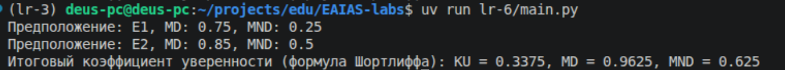

## Задание 6

Для запуска:
`uv run lr-6/main.py`

Результат работы:
```bash
Предположение: E1, MD: 0.75, MND: 0.25
Предположение: E2, MD: 0.85, MND: 0.5
Итоговый коэффициент уверенности (формула Шортлиффа): KU = 0.3375, MD = 0.9625, MND = 0.625
```
